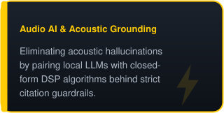
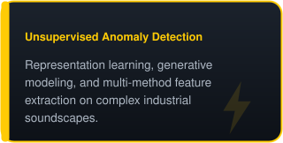
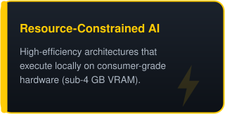
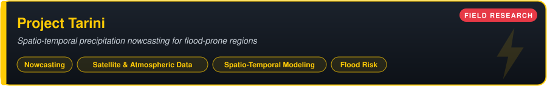
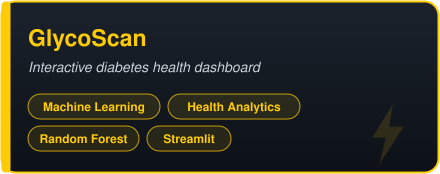
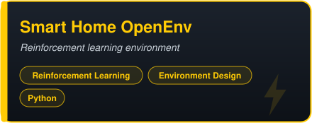
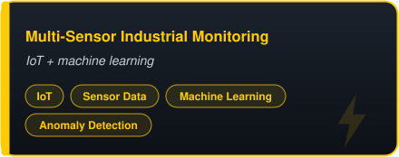
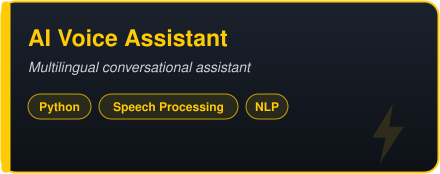

<!--
  PROFILE README: Shagun Thakur
  Theme: electric yellow #FFCB05 · ink #0D1117 · accent red #E63946
-->

  
    
  
  
  
  

 

<table>
  <tr>
    <td width="200" align="center" valign="top">
      
    </td>
    <td valign="top">
      
I'm a <b>Computer Science undergraduate</b> interested in how machines learn from <b>real-world physical signals</b>: acoustic waves, vibrations, and sensory time series.

      
My work spans <b>Machine Learning, Deep Learning, Audio Signal Processing, and Deterministic AI Grounding</b>. I focus on pairing closed-form signal mathematics with modern learning architectures to build <b>verifiable, hallucination-resistant systems</b> that run efficiently on accessible hardware.

    </td>
  </tr>
</table>

 

How do signal representations, learning methods, and deterministic guardrails interact to make ML systems reliable in real sensory environments?

<table>
  <tr>
    <td></td>
    <td></td>
    <td></td>
  </tr>
</table>

> In flood-vulnerable regions such as the Brahmaputra basin in Assam, extreme monsoon downpours and sudden cloudbursts can trigger catastrophic flash floods within hours, putting communities, agriculture, and infrastructure at severe risk.
>
> Traditional numerical weather forecasting often lacks the rapid, localized granularity that emergency response requires. **Project Tarini** is an ongoing research initiative investigating spatio-temporal precipitation nowcasting: how atmospheric and satellite sensory data can be used to forecast extreme rainfall hours in advance, providing lead time when every minute matters.

 

A deterministic, tool-augmented audio intelligence architecture engineered to run locally on budget consumer hardware (**RTX 3050, 4 GB**). Local LLM intent parsing (**Ollama `llama3.2:3b`**) is paired with closed-form DSP mathematics (**librosa, SciPy**) and verified by an independent **citation guardrail**.

<b>⚡ Inspect key capabilities &amp; benchmarks</b>

 

| Layer | Approach |
|---|---|
| **Intent parsing** | Local LLM (`llama3.2:3b` via Ollama) with Pydantic schema binding |
| **Computation** | Deterministic closed-form DSP: STFT, spectrograms, MFCCs, Welford online accumulation |
| **Verification** | Independent citation guardrail checks every claim against computed values |
| **Deployment** | Fully local and air-gapped capable; Streamlit interface |

| Evaluation Metric | Measured Result | Benchmark Comparison |
|---|---|---|
| **Citation Grounding Rate** | **99.0%** | vs. 87.8% unaugmented oracle |
| **Numeric Hallucination Rate** | **5.0%** | vs. 20.0% LLM baseline |
| **Abstention Accuracy** | **100.0%** | Safely refuses out-of-scope acoustic claims |
| **Peak VRAM Allocation** | **< 2.4 GB** | Engineered for budget 4 GB VRAM GPUs |
| **Average End-to-End Latency** | **< 6.7s** | Single-shot intent parsing + DSP execution |
| **Dataset Profiler Memory** | **< 100 MB** | Welford online accumulation (up to 2,000 files) |

 

 

A research-oriented pipeline investigating how evidence-based, multi-method feature engineering and deep generative models detect anomalies in industrial acoustic environments, using the **MIMII dataset**.

- Analyzes **temporal, spectral, and cepstral** representations across pumps, fans, valves, and slide rails.
- Investigates deep unsupervised architectures, including **Autoencoders** and **Normalizing Flows**, to detect anomalous machine states without labeled defect data.

 

<table>
  <tr>
    <td valign="top" width="50%">
      
      Streamlit app combining clinical reference-range evaluation with a Random Forest model trained on the Pima Indians Diabetes Database, providing risk estimates, feature-importance insights, and parameter flags. 
       
    </td>
    <td valign="top" width="50%">
      
      Production-oriented churn prediction platform with end-to-end ML pipelines, model benchmarking (XGBoost, Random Forest), feature explainability, and an interactive Streamlit interface. 
      
    </td>
  </tr>
  <tr>
    <td valign="top">
      
      Custom simulation environment for training reinforcement learning agents to optimize residential energy management, balancing occupant comfort against dynamic electricity tariffs. 
      
    </td>
    <td valign="top">
      
      Real-time multi-sensor monitoring system using IoT and machine learning for predictive degradation tracking and anomaly detection. 
      
    </td>
  </tr>
  <tr>
    <td valign="top">
      
      Voice-based assistant that processes spoken natural-language queries and responds with natural-sounding speech across multiple languages. 
      
    </td>
    <td></td>
  </tr>
</table>

 

**Languages** 
   

**Audio AI & Signal Processing** 
      

**Machine Learning & Deep Learning** 
       

**Grounded AI & Local LLMs** 
    

**Deployment & Tools** 
     

 

I'm always glad to discuss Machine Learning, Audio AI, signal processing, and verifiable intelligent systems.

  
  
  

 

